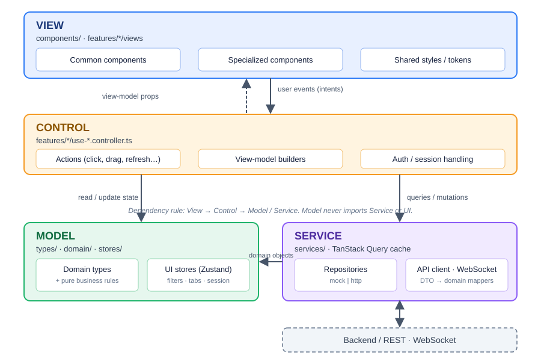
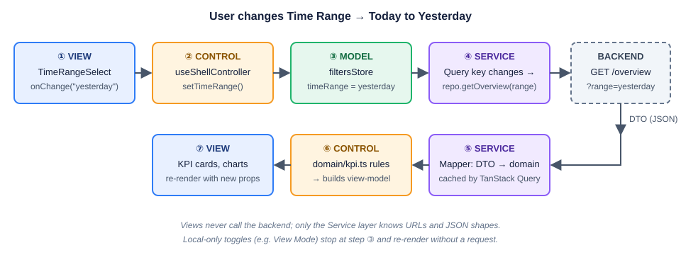

# FactoryX – Warehouse Control Tower: Frontend Design

> Scope: the Next.js web app that replaces the static prototype `tmp/FactoryX_AI-Powered Logistics Control Tower_Dashboard.html`.
> Stack (already in `frontend/`): Next.js 16 (App Router), React 19, Tailwind CSS 4, shadcn/ui (base-ui), ECharts, lucide-react, @xyflow/react.

---

## 1. Introduction

This design is based on the prototype `tmp/FactoryX_AI-Powered Logistics Control Tower_Dashboard.html` (4 pages: Overview, Warehouse Operations, Demand & Lead Time, Simulation & Recommendation).

### 1.1 Chosen architecture



*Text version of the same diagram:*

**Feature-sliced, 4-layer architecture (MVC/MVVM hybrid) with one-way dependencies.**

```
 ┌──────────────────────────────────────────────────────────────┐
 │ VIEW        views/common/, views/features/*                   │  React components. Render props/state only.
 │             (dumb, no fetch, no business rules)               │  Emit intents: onSort(), onRefresh()...
 └──────────────▲───────────────────────────────┬───────────────┘
        view-model (typed props)          user events (intents)
 ┌──────────────┴───────────────────────────────▼───────────────┐
 │ CONTROL     controllers/                                      │  Custom hooks = controllers.
 │             (thin orchestration)                              │  Map UI events → store updates / queries /
 │                                                               │  mutations. Hold no domain rules.
 └──────────────▲───────────────────────────────┬───────────────┘
              reads                           calls
 ┌──────────────┴──────────────┐   ┌────────────▼───────────────┐
 │ MODEL                        │   │ SERVICE (data access)      │
 │ domain/ : types, pure        │   │ services/ : api client,    │
 │   business logic (selectors, │   │   repositories, DTO→domain │
 │   status rules, formatters)  │   │   mappers, WebSocket       │
 │ stores/ : UI + session state │   │ Only layer that knows URLs │
 │   (Zustand)                  │   │ / HTTP / JSON shapes       │
 └──────────────────────────────┘   └────────────────────────────┘
```

**Dependency rule:** `View → Control → (Model, Service)`. Model never imports React components or services. Service never imports the model's stores. A View never calls `fetch`.

**Why this one** (vs. plain "components + fetch in useEffect", or Redux-everything):

1. **Testability** – business rules (`zoneStatus`, on-time rate, sort/filter) are pure functions in `domain/`; test without React or network.
2. **Swap-ability** – the prototype ships demo data; `services/` has a `mock` and a `http` implementation behind one interface (`DashboardRepository`), switched by env var. Views do not change when the real backend lands.
3. **Server state ≠ UI state** – TanStack Query owns fetched data (cache, polling, refetch); Zustand owns UI state (time range, view mode, tab order, sort). Mixing them is the main source of bugs in the prototype's global `S`.
4. **Fits Next.js App Router** – pages are Server Components that only compose Client features; `"use client"` stays at feature boundaries.
5. **Parallel work** – the team can build views against typed mock view-models while services are being wired.

### 1.2 Responsibilities per layer

| Layer | Owns | Must NOT |
|---|---|---|
| **View** | JSX, Tailwind classes, ECharts option building from view-model, a11y | fetch, compute KPIs, percents, tones or thresholds, read stores (everything arrives through props) |
| **Control** | `useXxxController()` hooks: subscribe to stores/queries, expose `{ vm, actions }`; debounce, optimistic updates, error toasts | contain domain formulas, JSX |
| **Model** | `models/types/` (domain entities), `models/domain/` (pure rules), `models/stores/` (Zustand slices) | import React UI, call HTTP |
| **Service** | `apiClient`, repositories, DTO mappers, WebSocket client, auth token handling | hold UI state, know about components |

### 1.3 Target folder layout

The top level of `frontend/` is the MVC split: `models/`, `views/`, `controllers/` (plus `services/` for data access and `app/` for routes). Three placement rules:

1. **Common components stay together** in `views/common/` (primitives, charts and shared building blocks side by side). Nothing shared lives under a feature folder.
2. **Specialized components stay with their page** in `views/features/<page>/`.
3. **Props stay with their component.** Every component's props type is in a `<component>.props.ts` file in the *same folder* as `<component>.tsx`, for common and specialized components alike (including props used by only one component). The props file is the view-model contract (§2.3); controllers import these types, views never import from `controllers/`.

```
frontend/
├─ app/                          # Next.js routes (thin; compose views + controllers)
│  ├─ (auth)/login/page.tsx
│  ├─ (dashboard)/layout.tsx     # header + tab bar + footer, providers
│  ├─ (dashboard)/overview/page.tsx
│  ├─ (dashboard)/warehouse/page.tsx
│  ├─ (dashboard)/demand/page.tsx
│  ├─ (dashboard)/simulation/page.tsx
│  └─ globals.css                # design tokens (see §2.4)
│
├─ views/                        # VIEW: dumb React components
│  ├─ common/                    # ALL shared components together (§2.1)
│  │  ├─ ui/                     # shadcn primitives (own props, as generated; no .props.ts)
│  │  ├─ charts/                 # ECharts option builders: buildThroughputOption, buildForecastOption, …
│  │  ├─ echart.tsx              echart.props.ts
│  │  ├─ sparkline.tsx           sparkline.props.ts
│  │  ├─ donut-gauge.tsx         donut-gauge.props.ts
│  │  ├─ kpi-card-shell.tsx      kpi-card-shell.props.ts
│  │  ├─ gauge-kpi-card.tsx      gauge-kpi-card.props.ts
│  │  ├─ leadtime-kpi-card.tsx   leadtime-kpi-card.props.ts
│  │  └─ …                       # one .tsx + one .props.ts per component
│  └─ features/                  # specialized components, one folder per page (§2.2)
│     ├─ overview/
│     │  ├─ overview-page.tsx          overview-page.props.ts
│     │  ├─ supply-rate-card.tsx       supply-rate-card.props.ts
│     │  ├─ throughput-card.tsx        throughput-card.props.ts
│     │  ├─ alerts-panel.tsx           alerts-panel.props.ts
│     │  └─ alert-item.tsx             alert-item.props.ts
│     ├─ warehouse/
│     ├─ demand/
│     ├─ simulation/
│     └─ shell/                  # header, tabs, footer, auth controls
│
├─ controllers/                  # CONTROL: hooks + view-model builders (no JSX)
│  ├─ overview.controller.ts     # useOverviewController() → { vm, actions }
│  ├─ overview.vm.ts             # builds the props types declared in views/features/overview/*.props.ts
│  ├─ warehouse.controller.ts
│  ├─ demand.controller.ts
│  ├─ simulation.controller.ts
│  └─ shell.controller.ts
│
├─ models/                       # MODEL: no React UI, no HTTP
│  ├─ types/                     # domain entities + DTO types (not component props)
│  ├─ domain/                    # pure business logic
│  │  ├─ kpi.ts  zone.ts  alert.ts  forecast.ts  simulation.ts  format.ts
│  │  └─ tone.ts  thresholds.ts  process.ts  throughput.ts
│  └─ stores/                    # Zustand (ui, filters, tabs, session)
│
├─ services/                     # SERVICE: data access
│  ├─ http/apiClient.ts  ws/realtime.ts
│  ├─ repositories/  { dashboard, warehouse, demand, simulation, auth }.repo.ts
│  ├─ mappers/       # DTO → domain
│  └─ mock/          # seeded demo data (port of BASE_DATA/getData)
├─ hooks/                        # generic hooks (useInterval, useEventSource)
└─ lib/                          # utils, constants, chart-theme.ts, chart-colors.ts (toneColor, processColor)
```

Import direction: `app → views, controllers`; `controllers → models, services, view props types`; `views → views/common, props files, models/domain/tone` (tone class lookup only); `models` imports nothing above it.

### 1.4 Data flow (one example)



User changes **Time Range** → `TimeRangeSelect` (View) calls `onChange("yesterday")` → `useShellController().setTimeRange` (Control) updates `filtersStore` (Model) → all feature queries include `timeRange` in their key → TanStack Query refetches via `dashboardRepo.getOverview(timeRange)` (Service) → mapper converts DTO → domain → controller derives the view-model with `domain/kpi.ts` → View re-renders.

---

## 2. View

Rules for every component: props-in / events-out, no data fetching, typed view-model props, Tailwind classes only through the shared tokens/variants in §2.4, no inline hex colours.

### 2.1 Common Components (`views/common/`, `views/common/ui/`)

#### Primitives (shadcn, `views/common/ui/`)

| Component | Purpose | Prototype origin | Status |
|---|---|---|---|
| `Button` (variants: default, ghost, link) | `.run`, `.vall` "View All ›" | `.run`, `.vall` | Implemented as `Button` (`views/common/ui/button.tsx`) |
| `Card` (+ `CardHeader/Title/Content`) | white/dark panels | `.card`, `.dark` | Implemented as `Card` (`views/common/ui/card.tsx`) |
| `Select` | all `select.dd` dropdowns | `select.dd` | Implemented as `Select` (`views/common/ui/select.tsx`) |
| `Tabs` | page navigation | `.nav` | Implemented as `Tabs` (`views/common/ui/tabs.tsx`) |
| `Table` | zone table | `table.zt` | Implemented as `Table` (`views/common/ui/table.tsx`) |
| `Badge` | demo tag, status, vehicle chips | `.demo`, `.vchip` | Implemented as `Badge` (`views/common/ui/badge.tsx`) |
| `Dialog` / `Sheet` | alert details, recommendation details | `#rec-more`, `#alert-viewall` | Implemented as `Dialog`, `Sheet` (`views/common/ui/dialog.tsx`, `sheet.tsx`) |
| `SegmentedControl` (on top of `ToggleGroup`) | Zone/Vehicle view, By Type/By Zone | `.seg` | Not implemented |
| `RadioGroup` | scenario picker | `.radio` | Not implemented |
| `Tooltip` | row hover details | `title=` | Not implemented |
| `Skeleton`, `Sonner` (toast) | loading / error feedback | – | Not implemented |
| `DropdownMenu`, `Avatar` | user menu (logout) | – | Not implemented |
| `Input`, `Label`, `Form` | login form | – | Not implemented |

#### Shared building blocks (`views/common/`)

| Component | Props (summary) | Used by | Status |
|---|---|---|---|
| `PanelCard` | `title`, `subtitle?`, `actions?`, `tone: "light"\|"dark"`, `children` – replaces repeated `.card`/`.dark` + `.hrow` header. `KpiCardShell` is its fixed-height KPI form: the KPI cards (gauge, lead-time, horizontal throughput) sit on it, the larger panels on `PanelCard` | every panel | Implemented as `PanelCard` (`views/common/panel-card.tsx`) – title, subtitle, actions; no `tone`; used by the alerts panel and the vertical throughput card |
| `PanelHeader` | `title`, `subtitle`, `actions` slot | PanelCard | Not implemented – header row is inlined in each panel |
| `FilterSelect` | `label?`, `options`, `value`, `onChange` – labelled `Select` with the prototype's `dd` look | all dropdowns | Implemented as `FilterSelect` (`views/common/filter-select.tsx`) – used by `AlertsPanel` and the vertical `ThroughputCard`; `DashboardHeader` still inlines `Select` |
| `StatusDot` | `status: "ok"\|"warn"\|"critical"\|"info"` | docks, table status, legends | Not implemented – header uses a "●" text character |
| `DeltaIndicator` | `text: string`, `tone: Tone`, `caption?` – ↑/↓ coloured; the tone comes from `deltaTone` in the controller | KPI cards, resources, totals | Implemented as `DeltaIndicator` (`views/common/delta-indicator.tsx`) |
| `ProgressBar` | `percent`, `appearance: { tone } \| { process }`, `height` – `.track/.fill` | throughput, resources | Implemented as `ProgressBar` (`views/common/progress-bar.tsx`) |
| `DonutGauge` | `percent`, `appearance: { tone } \| { process }`, `thick?` – `gauge-chart` | KPI cards | Implemented as `DonutGauge` (`views/common/donut-gauge.tsx`) – no `thick` prop yet |
| `Sparkline` | `data[]`, `process: ProcessKey` – any numeric array; the line always uses the **process colour**, never a status tone (§2.5) | KPI cards | Implemented as `Sparkline` (`views/common/sparkline.tsx`) – takes `process` |
| `KpiCardShell` | `title`, `children` | KPI cards | Implemented as `KpiCardShell` (`views/common/kpi-card-shell.tsx`) – optional `title` |
| `Icon` registry | `name` → lucide / custom SVG (forklift, agv, pallet, valve, solenoid, sensor, gear, housing, egr, building, factory, truck) | layout, resources, demand list | Implemented as `Icon` (`views/common/icon.tsx`) – the only file that holds SVG assets and imports `lucide-react` (enforced by ESLint `no-restricted-imports`); 6 product icons (valve, solenoid, sensor, gear, housing, egr) as inline SVG and 11 UI icons; the other names in this row are added when a component needs them |
| `Legend` | `items: {color, label, dashed?}[]` | layout, queue, simulation | Not implemented |
| `EmptyState` | message | alerts, tables | Not implemented |
| `ErrorState` + `RetryButton` | error + `onRetry` | every data panel | Not implemented |
| `LoadingState` | skeleton per panel | every data panel | Not implemented |
| `DemoDataBadge` | shows "Simulation / Demo Data" when repository = mock | header | Not implemented – demo text is only in `DashboardFooter` |
| `LastUpdated` | timestamp + relative age | header | Not implemented – date is hard-coded in `DashboardHeader` |
| `SignalBars` | `level 1-4`, `tone`, `label` | demand list | Implemented as `SignalBars` (`views/common/signal-bars.tsx`) – lit bars take the tone colour, unlit bars a neutral token; `label` is the accessible text |
| `EChart` | wrapper over echarts-for-react with shared theme, resize, `option` prop | all charts | Partial as `EChart` (`views/common/echart.tsx`, props in `echart.props.ts`) – SSR-safe wrapper with `option`, `height`; shared theme `FACTORY_THEME` (`lib/chart-theme.ts`) exists but is not applied |

### 2.2 Specialized Components (`views/features/*/`)

#### Shell (`views/features/shell/`)

| Component | Notes | Status |
|---|---|---|
| `DashboardHeader` | composes brand, title, `ScopeBadge`, `TimeRangeSelect`, `ViewModeToggle`, `LiveIndicator`, `UserMenu` | Partial as `DashboardHeader` (`views/features/shell/dashboard-header.tsx`) – title, Time Range select, Live text; no logo, scope, view mode or user menu; values not wired |
| `BrandLogo` | logo image (from `public/`) | Partial – "FactoryX" text `<h1>` inside `DashboardHeader`; no logo image |
| `ScopeBadge` | "In-plant Warehouse Logistics" flow text | Not implemented |
| `TimeRangeSelect` | Today / Yesterday / Last 7 days → `filtersStore` | Partial – inline `Select` in `DashboardHeader` (uncontrolled, not connected to any state) |
| `ViewModeToggle` | Zone View / Vehicle View | Not implemented |
| `LiveIndicator` | pulsing dot, "Live (5 min refresh)", clock, manual refresh button, pause toggle | Partial – static "Live (5 min refresh)" text and hard-coded timestamp in `DashboardHeader`; no refresh or pause |
| `UserMenu` | avatar, name, Logout | Not implemented |
| `DashboardTabs` | **reorderable** tab bar (drag), see §3.4 | Partial as `DashboardTabs` (`views/features/shell/dashboard-tabs.tsx`, props in `dashboard-tabs.props.ts`) – 4 tabs; Overview and Warehouse content is passed in by `app/dashboard/page.tsx`, the others show "Coming Soon"; not draggable, no routes |
| `SortableTab` | one draggable tab trigger + drag handle | Not implemented |
| `ExternalLinkTab` | "Solution Simulation ↗" | Not implemented |
| `DashboardFooter` | | Implemented as `DashboardFooter` (`views/features/shell/dashboard-footer.tsx`) |
| `LoginForm` | email/password, error message | Not implemented |

#### Overview (`views/features/overview/`)

| Component | Notes | Status |
|---|---|---|
| `OverviewPage` | grid composition | Implemented as `OverviewPage` (`views/features/overview/overview-page.tsx`) – takes `vm` and `actions`; data from `useOverviewController` (mock repository) |
| `SupplyRateCard` | thin wrapper on the shared `GaugeKpiCard` (ring, current stats, overview, notice, delta); design notes in [FE_GaugeKpiCard.md](FE_GaugeKpiCard.md) | Implemented as `SupplyRateCard` (`views/features/overview/supply-rate-card.tsx`) – wrapper on `GaugeKpiCard` (`views/common/gauge-kpi-card.tsx`) |
| `InboundLeadtimeCard` / `PickingLeadtimeCard` | built from a generic `LeadTimeKpiCard` (value, target, delta, sparkline) – **refactor to one component**; design notes in [FE_LeadTimeKpiCard.md](FE_LeadTimeKpiCard.md) | Implemented as `LeadTimeKpiCard` (`views/common/lead-time-kpi-card.tsx`), rendered twice; the two copies are deleted |
| `StagingCard` / `WarehouseCard` | thin wrappers on the same shared `GaugeKpiCard` as `SupplyRateCard`, each with its own tone rule; design notes in [FE_GaugeKpiCard.md](FE_GaugeKpiCard.md) | Implemented as `StagingCard`, `WarehouseCard` (`views/features/overview/`) – wrappers on `GaugeKpiCard` |
| `ThroughputCard` (`orientation="horizontal"`) | progress bars per process, actual data only, same data and colours as the vertical card (§2.3.1); design notes in [FE_ThroughputCard.md](FE_ThroughputCard.md) | Implemented as `ThroughputCard` (`views/features/overview/throughput-card.tsx`) with `ThroughputHorizontalCard` |
| `ThroughputCard` (`orientation="vertical"`) | column chart per process, actual and target, with Actual / Actual vs Target dropdown (§2.3.1); design notes in [FE_ThroughputCard.md](FE_ThroughputCard.md) | Implemented as `ThroughputCard` with `ThroughputVerticalCard` – mode select wired (Actual / Actual vs Target) |
| `AlertsPanel` | filter select + View All; reads the shared `Alert` model ([FE_AlertModel.md](FE_AlertModel.md)) | Implemented as `AlertsPanel` (`views/features/overview/alerts-panel.tsx`) – filter wired through `uiStore`, Info option and View All; list from the mock repository |
| `AlertItem` | icon by severity, title, detail, time; one `AlertItem` of the shared `Alert` model, also the source of the supply card's overdue notice ([FE_AlertModel.md](FE_AlertModel.md)) | Implemented as `AlertItem` (`views/features/overview/alert-item.tsx`) – icon and row style follow severity |

#### Warehouse Operations (`views/features/warehouse/`)

| Component | Notes | Status |
|---|---|---|
| `WarehouseLayoutPanel` | dark panel: title + view toggle + scroll area + legend. Consider @xyflow/react vs CSS grid; CSS grid is enough for v1 | Not implemented |
| `LayoutStage` | generic stage box (`tone`: receiving/storage/picking/staging/handover) | Not implemented |
| `ReceivingStage` + `DockCard` | docks with status dot | Not implemented |
| `PutawayWaitingStage` | queue count + avg minutes | Not implemented |
| `StorageStage`, `PickingStage`, `StagingStage` | grids of `ZoneTile` | Not implemented |
| `ZoneTile` | name, %, `ProgressBar`, alert badge, `VehicleChip`s (vehicle view) | Not implemented |
| `VehicleChip` | FL / AGV, offline state | Not implemented |
| `HandoverStage` | ready pallets + to-production | Not implemented |
| `FlowArrow` | between stages | Not implemented |
| `VehicleLane` | dashed lane with in-progress / delayed segments | Not implemented |
| `ResourceStatusPanel` | `SegmentedControl` + `ResourceRow[]` | Not implemented |
| `ResourceRow` | icon, used/total, bar, %, delta | Not implemented |
| `ZonePerformanceTable` | sortable columns, area filter | Not implemented |
| `SortableHeaderCell` | `th` with asc/desc indicator, keyboard accessible | Not implemented |
| `QueueByZoneChart` | stacked horizontal bars (Waiting / In-progress), Top N select | Not implemented |

#### Demand & Lead Time (`views/features/demand/`)

| Component | Notes | Status |
|---|---|---|
| `ProductDemandPanel` | sort select, list, total | Implemented as `ProductDemandPanel` (`views/features/demand/product-demand-panel.tsx`) – sort wired through `uiStore`; rows already sorted by the controller; empty state text |
| `ProductDemandRow` | product icon, name, count, `SignalBars` | Implemented as `ProductDemandRow` (`views/features/demand/product-demand-row.tsx`) – signal level from `signalLevel`, colour from the product's `priority` through `productTone` |
| `DemandTotal` | total + delta | Implemented as `DemandTotal` (`views/features/demand/demand-total.tsx`) – total computed from the rows; a rise is `bad` (`deltaTone(deltaPct, "down")`) |
| `DemandForecastChart` | bars + capacity step lines + forecast shading; range 7/14 | Implemented as `DemandForecastChart` (`views/features/demand/demand-forecast-chart.tsx`) – option from `buildForecastOption`; the capacity lines come from the Overview totals (`capacityLines`, turns per day in `models/domain/capacity.ts`) |
| `LeadTimeTrendChart` | 4 process lines, dotted forecast segment; range select | Implemented as `LeadTimeTrendChart` (`views/features/demand/lead-time-trend-chart.tsx`) – option from `buildLeadTimeOption`; for today the Receiving and Picking points come from the Overview snapshot (`resolveLeadTimeSeries`) |

#### Simulation & Recommendation (`views/features/simulation/`)

| Component | Notes | Status |
|---|---|---|
| `ScenarioPanel` | `RadioGroup` of 6 scenarios + Run button | Not implemented |
| `ScenarioComparisonTable` | Base vs selected, green/red by better/worse | Not implemented |
| `SimulationResultGrid` | 4 metric bar charts, dims non-selected | Not implemented |
| `SimulationMetricChart` | one chart, reusable | Not implemented |
| `RecommendationPanel` | sort select + details toggle | Not implemented |
| `RecommendationItem` | rank badge, title, sub, detail, metrics | Not implemented |
| `ImpactMetric` | value + label green pill | Not implemented |

### 2.3 View-model contract

Every specialized component receives a **view-model** (display-ready values: formatted strings, tone enums, percentages), never raw DTOs. View-models are built in `controllers/*.vm.ts` by calling `models/domain/` functions; the props type of each component lives beside it in `<component>.props.ts` (§1.3). Example:

```ts
// views/common/gauge-kpi-card.props.ts – the props type is the view-model; controllers import it
export type GaugeKpiBaseProps = { title: string; currentStats: { current: number; total: number };
                                  percent: number; ringTone: Tone; /* … */ };   // see FE_GaugeKpiCard.md

// controllers/overview.vm.ts – builder function only; it calls models/domain/ for percent and tones
export const buildSupplyRateVM = (snapshot: OverviewSnapshot): SupplyRateCardProps => { /* … */ };
```

#### 2.3.1 One data set, two presentations: `ThroughputCard`

The Overview page shows the same throughput information twice: as horizontal progress bars (KPI row, "Throughput (Today)") and as a vertical column chart (main area, "Throughput by Process"). They are **one component with an `orientation`**, not two components:

1. **Same data.** Both draw from the same `ThroughputItem[]` (one entry per process), built once in `useOverviewController`.
2. **Same process colours.** Colours identify the process, not good/bad. They are defined once as `--fx-process-*` tokens (§2.4) and a `PROCESS_COLOR` map in `domain/process.ts`. Both orientations read it; no hex values in either file. (Today the two files carry slightly different blues, `#3b82f6` and `#3478f6`.)
3. **Same parent card and one entry function.** `ThroughputCard` renders the common `PanelCard` and, depending on `orientation`, returns the horizontal or the vertical card.
4. **Different content, by design.**

| | `orientation="horizontal"` | `orientation="vertical"` |
|---|---|---|
| Shows | **actual** only, for the selected period (default "Today") | **actual and target** |
| Header | title, period label, unit "(pallets)" | title only |
| Dropdown | none | Actual / Actual vs Target |
| Body | one `ProgressBar` per process, value at the right | column chart (`EChart`), y-axis "Pallets" |
| Target data | ignored | shown as grouped columns when the mode is "Actual vs Target" |

```ts
// domain/process.ts
export type ProcessKey = "inbound" | "putaway" | "picking" | "delivery";
export const PROCESS_COLOR: Record<ProcessKey, string> = {
  inbound: "var(--fx-process-inbound)", putaway: "var(--fx-process-putaway)",
  picking: "var(--fx-process-picking)", delivery: "var(--fx-process-delivery)",
};

// models/types/throughput.ts – domain entity
export type ThroughputItem = { process: ProcessKey; label: string; actual: number; target?: number };

// views/features/overview/throughput-card.props.ts – props type, beside the component
export type ThroughputItemVM = ThroughputItem & { barPercent: number };    // barPercent computed in the controller
type ThroughputCardBase = { items: ThroughputItemVM[]; unit?: string };    // identical for both

export type ThroughputCardProps =
  | (ThroughputCardBase & { orientation: "horizontal"; periodLabel?: string })
  | (ThroughputCardBase & { orientation: "vertical"; mode: "actual" | "target";
                            axisMax: number;                             // computed in the controller
                            onModeChange: (m: "actual" | "target") => void });
```

```tsx
export function ThroughputCard(props: ThroughputCardProps) {
  return props.orientation === "horizontal"
    ? <ThroughputHorizontalCard {...props} />   // PanelCard + ProgressBar rows, actual only
    : <ThroughputVerticalCard {...props} />;    // PanelCard + mode FilterSelect + EChart
}
```

Page usage: `<ThroughputCard orientation="horizontal" items={throughput} periodLabel="Today" />` in the KPI row and `<ThroughputCard orientation="vertical" items={throughput} mode={mode} onModeChange={setMode} />` in the main area. The data and colours come from the same controller, so the two can never disagree. Only the vertical card has a mode state, because only it has a dropdown. Details: [FE_ThroughputCard.md](FE_ThroughputCard.md).

The same pattern applies to any other metric shown in two forms (for example occupancy shown as a gauge or as a bar): one card, one data prop, one `orientation` or `variant`.

### 2.4 Shared styles (applied site-wide, once)

All visual constants live in **`app/globals.css`** as CSS variables mapped into Tailwind 4 via `@theme inline` (the project already does this for shadcn). No component uses a raw hex value; the existing `bg-[#081c4b]` / `text-white` repeated in `dashboard-tabs.tsx` should move to tokens.

```css
/* app/globals.css — dashboard tokens (values taken from the prototype) */
:root {
  /* surfaces */
  --fx-bg:            #071533;   /* page */
  --fx-bg-glow:       #143272;
  --fx-panel-dark:    #0d2658;
  --fx-panel-dark-2:  #14336f;
  --fx-panel-border:  #2b4c8c;
  --fx-card:          #ffffff;
  --fx-ink:           #16213d;
  --fx-muted:         #69748f;
  --fx-text-on-dark:  #e8eefc;
  --fx-text-soft:     #c6d3f2;
  --fx-grid:          #eef1f6;
  /* semantic */
  --fx-primary:  #2f7cf6;
  --fx-success:  #1fb46b;
  --fx-warning:  #f59a23;
  --fx-caution:  #f2c200;
  --fx-danger:   #e5413e;
  --fx-info:     #2f7cf6;
  --fx-purple:   #8b5cf6;
  --fx-teal:     #14b8a6;
  --fx-slate:    #7b8db3;
  /* process identity colours – one definition, used by every card/chart (§2.3.1) */
  --fx-process-inbound:  #2f7cf6;
  --fx-process-putaway:  #1fb46b;
  --fx-process-picking:  #f59a23;
  --fx-process-delivery: #8b5cf6;
  /* shape & type */
  --fx-radius-card: 6px;
  --fx-font: "Barlow Semi Condensed", "Roboto Condensed", "Arial Narrow", "Segoe UI", Arial, sans-serif;
}
@theme inline {
  --color-fx-bg: var(--fx-bg);
  --color-fx-panel: var(--fx-panel-dark);
  --color-fx-border: var(--fx-panel-border);
  --color-fx-ink: var(--fx-ink);
  --color-fx-muted: var(--fx-muted);
  --color-fx-primary: var(--fx-primary);
  --color-fx-success: var(--fx-success);
  --color-fx-warning: var(--fx-warning);
  --color-fx-danger: var(--fx-danger);
  --font-sans: var(--fx-font);
}
body { background: radial-gradient(1400px 700px at 50% -15%, var(--fx-bg-glow) 0, var(--fx-bg) 62%); color: var(--fx-text-on-dark); }
@media (prefers-reduced-motion: reduce) { .fx-pulse { animation: none; } }
```

| Concern | Where | Rule |
|---|---|---|
| Font | `app/layout.tsx` via `next/font/google` (Barlow Semi Condensed 400–700) | replaces the `<link>` in the prototype |
| Colour tokens | `globals.css` (above) | status → colour mapping lives in **one** place: `domain/tone.ts` (`Tone` → CSS var class) |
| Chart theme | `lib/chart-theme.ts` (existing) reads the same tokens; one palette for all charts. ECharts needs real colour strings, so option builders call `toneColor(tone)` / `processColor(key)` from `lib/chart-colors.ts`, never hex | |
| Component variants | `class-variance-authority` in each common component (`tone`, `size`) | no ad-hoc class strings in features |
| Layout | `PageGrid` helper = 12-col grid with `gap-2`; page max-width 1920 px, padding `px-3` | |
| Responsive | breakpoints from prototype: ≤1500 px KPI row → 3 cols; ≤900 px single column | |
| Dark/light | Header, tabs, layout panel = dark tone; cards = light tone via `PanelCard tone` | |
| A11y | focus ring `2px solid var(--fx-primary)`, `aria-sort` on sortable headers, `prefers-reduced-motion` | |
| Data-driven styling | see §2.5 | components receive a `Tone`, never a colour |

### 2.5 Data-driven styles (style changes in response to data)

Some styles must change when the data changes: an alarm, a warning, a late deadline, missing data, a target not met, or any value with a negative meaning. This is **not** done inside components. The flow is always:

```
data (Model) ──► rule (domain/tone.ts, thresholds.ts) ──► Tone ──► component variant ──► CSS token
```

1. **Rules decide the tone.** Pure functions in `domain/` take data and return a `Tone`. They contain every threshold and "is up good?" decision, and are unit tested.
2. **Controllers attach the tone to the view-model** (`{ value, delta, tone }`), so Views never compare numbers.
3. **Components map tone to style** through one `cva` variant (`tone`) and the tokens in §2.4. No component contains a hex colour or an `if (value > …)`.

#### Tone set

| Tone | Meaning | Token | Typical use |
|---|---|---|---|
| `good` | on target / healthy | `--fx-success` | on-time, below-target lead time, normal zone |
| `info` | informational, no action | `--fx-info` | Info alerts, offline notice |
| `warning` | approaching a limit | `--fx-caution` / `--fx-warning` | occupancy 75–89 %, queue growing |
| `critical` | alarm, action needed | `--fx-danger` | occupancy ≥ 90 %, critical alert, offline resource |
| `bad` | negative result (not an alarm) | `--fx-danger` | metric moved the wrong way, target missed |
| `late` | one item's deadline passed / at risk | `--fx-danger` + clock icon | a single overdue request, delayed delivery, delayed vehicle lane. An aggregate count such as "8 overdue requests" uses `thresholdRule` and is `critical` (FE_GaugeKpiCard.md) |
| `unavailable` | no data, stale data, source down | `--fx-slate` | "–" value, greyed card |
| `neutral` | no judgement | `--fx-primary` / ink | plain figures, forecast |

`bad`, `late` and `critical` share the red token but differ in **non-colour cues** (see below), so colour is never the only signal.

#### Rules (all in `domain/`, thresholds in `domain/thresholds.ts`)

| Situation | Rule function | Example from the prototype |
|---|---|---|
| Alarm / warning from occupancy and queue time | `zoneTone(occupancy, leadMin)`, `zoneStatus(...)` – built on `OCCUPANCY_RULE` | occupancy ≥ 90 % → `critical`; 75–89 % or lead time ≥ 25 min → `warning`; below 75 % → `good` |
| Layout tile bar colour | `layoutTone(occupancy, leadMin)` – same function as `zoneTone` | same tone as the zone status; alert dot when the tone is `critical` (≥ 90 %) |
| Negative change vs. yesterday | `deltaTone(deltaPct, goodDirection)` | lead time ↑ → `bad`, throughput ↑ → `good` |
| Target not met | `targetTone(value, target, direction)` | picking 28 min vs. target ≤ 30 min → `good`; 32 min → `bad` |
| Late deadline (one item) | `deadlineTone({ dueAt, now, doneAt? })` | a single request or vehicle task past its due time → `late`; due within the warning window → `warning` |
| Ring / percentage KPI (supply on-time, staging, warehouse) | `thresholdRule({ direction, goodAt, warningAt })` – one abstract function, thresholds per card in `domain/thresholds.ts` | on-time 96 % → `warning`; warehouse 68 % → `good`; 8 overdue → `critical` (see [FE_GaugeKpiCard.md](FE_GaugeKpiCard.md)) |
| Alert severity | `alertTone(severity)` | `critical` / `warning` / `info` → matching tone and icon; the same `AlertItem` also colours KPI notices ([FE_AlertModel.md](FE_AlertModel.md)) |
| Table cell highlight | `cellTone(column, value)` | queue ≥ 8 or lead time ≥ 28 min → `bad` |
| Missing or stale data | `dataTone({ value, fetchedAt, maxAge })` | `null`, error or older than 2 × refresh interval → `unavailable` |
| Resource problem | `resourceTone(resource)` | AGV offline / battery low → `warning` |

**Decided thresholds** (defined once in `domain/thresholds.ts`, used by cards, tiles, tables and alerts):

| Rule | good | warning | critical |
|---|---|---|---|
| `OCCUPANCY_RULE` (zones, staging, warehouse) | < 75 % | 75–89 % | ≥ 90 % |
| `SUPPLY_ONTIME_RULE` (on-time rate, higher is better) | ≥ 98 % | 90–97 % | < 90 % |
| `OVERDUE_RULE` (overdue requests) | 0 | 1–3 | ≥ 4 |
| Offline vehicle (alert and resource row) | – | offline | – |

Delta colours: a rising occupancy is `bad` (red); there is no neutral band. The limits are decided values for the design; replace them with the plant's real targets when available, in one place. Documents using them: [FE_GaugeKpiCard.md](FE_GaugeKpiCard.md) §3.2, [FE_AlertModel.md](FE_AlertModel.md) §3.1.

```ts
// domain/tone.ts
export type Tone = "good" | "info" | "warning" | "critical" | "bad" | "late" | "unavailable" | "neutral";

export type GoodDirection = "up" | "down";

// deltaPct is a number; the display string ("+2%") is made by format.ts, never parsed back
export const deltaTone = (deltaPct: number | null, goodDirection: GoodDirection): Tone => {
  if (deltaPct == null || Number.isNaN(deltaPct)) {
    return "unavailable";
  }
  if (deltaPct === 0) {
    return "neutral";
  }
  return (deltaPct > 0) === (goodDirection === "up") ? "good" : "bad";
};

export const targetTone = (v: number | null, target: number, dir: "max" | "min"): Tone => {
  if (v == null) {
    return "unavailable";
  }
  return (dir === "max" ? v <= target : v >= target) ? "good" : "bad";
};
```

When several rules apply to the same element, take the **most severe** tone: `critical` > `late` > `bad` > `warning` > `info` > `good` > `neutral`; `unavailable` overrides all, because a judgement on missing data is not trustworthy. A helper `worstTone(...tones)` in `domain/tone.ts` does this.

#### How components apply a tone

| Element | Change when tone changes |
|---|---|
| `DeltaIndicator`, KPI value | text colour and arrow from the `tone` prop, computed by `deltaTone(deltaPct, goodDirection)` in the controller (e.g. "-12%", "+15%"); `unavailable` shows "–" and hides the delta |
| `Sparkline` | Implemented as `Sparkline` (`views/common/sparkline.tsx`) – takes `process` |
| `DonutGauge`, `ProgressBar` | fill colour from `tone`; `unavailable` shows an empty ring / track |
| `ZoneTile`, `ResourceRow` | bar colour, border and alert dot (`critical`, `late`) |
| Table cell | background tint and bold text (`bad`, `critical`) |
| `AlertItem` | Implemented as `AlertItem` (`views/features/overview/alert-item.tsx`) – icon and row style follow severity |
| `PanelCard` | Implemented as `PanelCard` (`views/common/panel-card.tsx`) – title, subtitle, actions; no `tone`; used by the alerts panel and the vertical throughput card |

Components take a `tone` prop and map it with a single `cva` variant per component; the same `Tone` → class map is reused by ECharts builders through a `toneColor(tone)` helper that reads the CSS tokens (ECharts needs real colour values, not class names).

#### Rules for accessibility and behaviour

* **Colour is never the only cue.** `critical` shows a `!` icon, `late` a clock icon, `bad` an arrow or "▲/▼" with text, `unavailable` shows "–" and the words "No data". Add `aria-label` / `title` text such as "Critical: occupancy 90 %".
* **Alarms may animate** (pulse on the alert dot), but must respect `prefers-reduced-motion`.
* **Tone changes with data, not with time of render.** The same input always gives the same tone, so the view is predictable and testable.
* **Thresholds are configuration**, not component code, in `domain/thresholds.ts`, so they can later come from the backend (per plant or per process) without touching any View.
* **Stale data:** the last good values stay visible but are marked `unavailable` once older than the allowed age, with `LastUpdated` showing the age.

---

## 3. Control

Controllers are custom hooks in `controllers/`. Views call **actions**; actions are the only way UI events change state or trigger requests. They are defined once in the shell/global controller when shared, and in the feature controller when local.

### 3.1 Action catalogue

| # | Action | Trigger (View event) | What the controller does | State touched |
|---|---|---|---|---|
| A1 | `setTimeRange(range)` | `TimeRangeSelect.onChange` | write to `filtersStore`; all queries re-key and refetch | `filtersStore.timeRange` |
| A2 | `setViewMode(mode)` | `ViewModeToggle` click (header **and** layout panel share it) | write to store; layout re-renders (no refetch) | `filtersStore.viewMode` |
| A3 | `setLocalFilter(key, value)` | local select/segment change (alert level, throughput mode, area, queue top-N, demand sort, forecast range, lead range, rec sort, resource group) | write to the feature's slice of `uiStore`; derive VM with domain selector | `uiStore.<feature>.<key>` |
| A4 | `toggleSort(column)` | click / Enter / Space on sortable header | cycles asc → desc; sorted with `domain/sort.ts` | `uiStore.zoneTable.sort` |
| A5 | `selectItem(id)` / `openDetails(id)` | click alert, "View All ›", "View Details ›" | open `Dialog`/`Sheet` or toggle inline detail | controller-local `useState` (use `uiStore` only if two components share the selection) |
| A6 | `runSimulation(scenarioId)` | Run Simulation click | `useMutation` → `simulationRepo.run`; disable button while pending; toast on error; store result | mutation + `simulationStore.selected` |
| A7 | `refresh()` | Refresh button, tab re-focus, auto-timer | `queryClient.invalidateQueries` for the active page; update `LastUpdated` | query cache |
| A8 | `toggleAutoRefresh()` | Live indicator pause/resume | start/stop the interval (default 5 min) | `uiStore.autoRefresh` |
| A9 | `reorderTabs(from, to)` | drag-and-drop on tabs | see §3.4 | `layoutStore.tabOrder` |
| A10 | `selectTab(id)` | click tab / route change | `router.push`; no full reload | URL |
| A11 | `login(credentials)` | LoginForm submit | `authRepo.login` → store session → redirect | `sessionStore` |
| A12 | `logout()` | UserMenu → Logout | `authRepo.logout`, clear stores + query cache, redirect `/login` | `sessionStore`, cache |
| A13 | `openExternal(url)` | "Solution Simulation ↗" | `window.open(url, "_blank", "noopener")` | – |

Naming: hooks `useShellController`, `useOverviewController`, `useWarehouseController`, `useDemandController`, `useSimulationController`, `useAuthController`. Each returns `{ vm, status, actions }`:

```ts
const { vm, status, actions } = useWarehouseController();
// status: "loading" | "error" | "ready"; actions.toggleSort, actions.setViewMode, actions.refresh ...
```

### 3.2 Refresh data (A7, A8)

* **Server state:** TanStack Query, `staleTime: 60s`, `refetchInterval: 5 min` (from `REFRESH_MS` constant) only while `autoRefresh` is on and the tab is visible (`refetchIntervalInBackground: false`).
* **Manual refresh:** invalidates only queries of the active page (key prefix `["overview", …]`), shows a spinner on the Refresh button and updates `LastUpdated` from `dataUpdatedAt`.
* **Real-time alerts (optional, later):** `services/ws/realtime.ts` (existing `hooks/useWebSocket.ts` becomes a thin adapter) pushes alert/queue events and patches the query cache with `queryClient.setQueryData`; falls back to polling when the socket is closed.
* **Errors:** keep showing last good data, display a non-blocking `ErrorState` banner with Retry; 401 triggers `logout()`.

### 3.3 Click events (A3, A4, A5, A6)

* Handlers are created in the controller with `useCallback`, passed down as `on*` props – Views never touch stores.
* Use **one generic handler** for all local dropdowns: `actions.setLocalFilter("alertLevel", v)`, so the 8 select handlers in the prototype collapse into one pattern.
* Toggles that only change presentation (view mode, alert level, sort) are **client-only** (no network). Toggles that change the query (time range, forecast range, lead range) change the query key.
* Destructive or expensive clicks (`Run Simulation`) are guarded: disabled while pending, de-duplicated by mutation key.

### 3.4 Drag to reorganize tabs (A9)

* Library: **`@dnd-kit/core` + `@dnd-kit/sortable`** (keyboard accessible; works with React 19). Horizontal list strategy, pointer sensor with 6 px activation distance (so a click still selects the tab) plus keyboard sensor (Space to lift, arrows to move).
* `DashboardTabs` renders `SortableContext items={tabOrder}`; each `SortableTab` uses `useSortable(id)`.
* Controller:

```ts
reorderTabs(activeId, overId) {
  if (activeId === overId) {
    return;
  }
  layoutStore.setTabOrder(arrayMove(order, order.indexOf(activeId), order.indexOf(overId)));
}
```

* `layoutStore.tabOrder` is persisted (Zustand `persist` → `localStorage`, key `fx.tabOrder.v1`; later synced to the user profile via `userPrefsRepo`). Unknown/missing ids are reconciled against the static tab registry on load (`domain/tabs.ts`), so adding a new page never breaks a saved order.
* The "Solution Simulation ↗" external link is pinned at the end and is **not** draggable.
* Reordering changes only the order of tab triggers; the active tab and route stay the same.

### 3.5 Login / Log out (A11, A12)

* **Session:** server-issued **httpOnly cookie** (preferred over `localStorage` tokens). The browser never reads the token; `apiClient` uses `credentials: "include"`.
* **Route protection:** `proxy`/middleware (check `AGENTS.md` – Next.js 16 conventions differ, read `node_modules/next/dist/docs/` before writing) redirects unauthenticated requests for `(dashboard)/*` to `/login?next=…`.
* **Login flow:** `LoginForm` → `actions.login` → `authRepo.login()` → on success store `user` (name, role) in `sessionStore`, `router.replace(next ?? "/overview")`; on failure show inline error, no toast spam.
* **Logout flow:** `UserMenu` → `actions.logout` → `authRepo.logout()` (even if it fails) → clear `sessionStore`, `queryClient.clear()`, reset UI stores except `tabOrder` preference → `router.replace("/login")`.
* **Expiry:** `apiClient` interceptor maps `401` to a single `onUnauthorized` callback registered by the shell controller (idempotent) so parallel failing queries trigger one logout.
* **Roles (future):** `domain/permissions.ts` exposes `can(user, "run-simulation")`; Views hide actions via a `<Can>` wrapper – the check is *not* done inside components.

### 3.6 Keyboard & accessibility actions

Sortable header: Enter/Space = `toggleSort`; tabs: arrow keys + drag via keyboard sensor; dialogs: Esc closes; Refresh: `R` shortcut (optional).

---

## 4. Model & Service (reference, for completeness)

**Domain types** (`models/types/`): `Kpi`, `ThroughputStep`, `Alert` / `AlertItem{kind, severity, facts}` (see [FE_AlertModel.md](FE_AlertModel.md)), `Zone{area, occupancy, queue, avgLeadMin}`, `StagingArea`, `Dock`, `Vehicle{kind, zone, offline}`, `ResourceGroup`, `ProductDemand`, `Forecast`, `LeadTimeSeries`, `Scenario`, `SimulationResult`, `Recommendation`, `TimeRange`, `ViewMode`.

**Pure business rules** (`models/domain/`, ported from the prototype and unit tested):

| Function | From prototype |
|---|---|
| `onTimeRate(delivered, total)` | `renderKpis` |
| `zoneStatus(occupancy, leadMin)` → Normal/Warning/Critical | `zoneStatus` |
| `zoneTone(occupancy, leadMin)` | `layoutColor` |
| `topQueues(queues, n)` | `renderQueue` |
| `sortProducts(list, mode)` | `renderDemand` |
| `isBetter(metric, base, value)` | `renderSim` |
| `sortRecommendations(list, mode)` | `renderRecs` |
| `deltaTone(deltaPct, goodDirection)` | `deltaSpan` |
| `thresholdRule(options)`, `percentOf(current, total)` | ring KPIs ([FE_GaugeKpiCard.md](FE_GaugeKpiCard.md)) |
| `noticeFromAlert`, `deriveAlerts`, `formatAlertDetail` | alerts ([FE_AlertModel.md](FE_AlertModel.md)) |
| `barPercent`, `axisMax` | throughput ([FE_ThroughputCard.md](FE_ThroughputCard.md)) |

**Repositories** (`services/repositories/`): `getOverview(range)` (one snapshot that also carries the `Alert` list; the alert level filter is applied in the browser, see [FE_AlertModel.md](FE_AlertModel.md) §4), `getWarehouseSnapshot(range)`, `getDemand(range)`, `getForecast(days)`, `getLeadTimeTrend(range)`, `getScenarios()`, `runSimulation(id)`, `getRecommendations()`, `login`, `logout`, `getMe`, `getUserPrefs`/`saveUserPrefs`. Each returns **domain** objects (mapped from DTOs). `services/mock/` ports `BASE_DATA` and `getData()` so the UI works before the backend exists; selected by `NEXT_PUBLIC_DATA_SOURCE=mock|http`.

**State split:**

| State | Tool | Examples |
|---|---|---|
| Server state | TanStack Query | all dashboard data, simulation result |
| UI/global state | Zustand (`filtersStore`, `uiStore`, `layoutStore`, `sessionStore`) | time range, view mode, sort, tab order, user |
| Ephemeral component state | `useState` | dialog open, hover |

**New dependencies to add:** `@tanstack/react-query`, `zustand`, `@dnd-kit/core`, `@dnd-kit/sortable`, `@dnd-kit/utilities`, `sonner` (toasts), `vitest` + `@testing-library/react` + `@testing-library/jest-dom` + `jsdom` (tests).

---

## 5. Migration notes from the current `frontend/`

1. Move shared header filters and tab logic into stores and `controllers/shell.controller.ts`. The header, footer and tab bar already live in `views/features/shell/`.
2. Replace `lib/mock-data.ts` with `services/mock/` behind a repository; remove direct imports of mock data in cards.
3. Merge the near-duplicate cards (`inbound-leadtime-card` / `picking-leadtime-card`, `staging-card` / `warehouse-card`) into `LeadTimeKpiCard` ([FE_LeadTimeKpiCard.md](FE_LeadTimeKpiCard.md)) and the three ring cards into `GaugeKpiCard` ([FE_GaugeKpiCard.md](FE_GaugeKpiCard.md)); merge `throughput-summary-card` / `throughput-chart` into `ThroughputCard` ([FE_ThroughputCard.md](FE_ThroughputCard.md)).
4. Replace hard-coded colours (`#081c4b`, etc.) with the tokens in §2.4.
5. Convert the single-page tab view to route segments (`/overview`, `/warehouse`, …) so URLs are shareable, matching the prototype's hash routes.
6. The prototype uses Plotly; the project uses ECharts – port chart options once into chart option builders in `views/common/charts/` (`buildThroughputOption`, `buildForecastOption`, …) that take a view-model.
7. Build `models/domain/tone.ts` and `models/domain/process.ts` (with the `--fx-process-*` tokens and `lib/chart-colors.ts`) first. Every card depends on them.
8. The "Status" columns in §2.2 describe the code as it was before the migration. `components/`, `features/` and `types/` no longer exist; all code is in the layout of §1.3.
